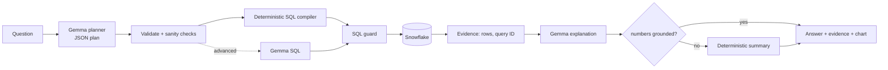

# DataMind — Ask. Query. Verify.

**ZeroDay OSS Hacktoberfest 2026 · PS1 "Talk to Your Data"**

DataMind lets anyone ask questions about structured data in plain English. It answers with **live Snowflake
queries**, visualizes the result, and shows the evidence behind every answer: the exact SQL that ran, the
Snowflake query ID, the returned rows, the filters, joins and calculations, and every assumption it made.
Google **Gemma** interprets the questions and explains the results. Deterministic code builds the SQL, guards it and
checks the facts.

> Status: see [Verification status](#verification-status). Read it before relying on any claim in this README.

## Problem

Analysts, students and non-technical users need SQL to explore databases. Dashboards only answer predefined
questions, and generic chatbots invent numbers. DataMind computes answers from the real data and shows its work.
When the data cannot answer a question, it says so.

## Features

* **Natural-language questions** with follow-up context (the last 3 turns).
* **Schema discovery** from `INFORMATION_SCHEMA`, plus a schema explorer in the sidebar. Distinct values of configured
  categorical columns are fetched once, so filters use real values.
* **Gemma query planning:** Gemma returns a strict JSON plan, constrained by a JSON schema and validated by Pydantic.
  A **deterministic compiler** turns the plan into SQL. Join paths come from configured relationships, named metrics
  come from config, and every value becomes a typed, escaped literal.
* **Advanced path:** for questions the plan format cannot express (e.g. the top item within each group), Gemma writes
  SQL directly. That SQL goes through the same guard and is labelled *model-written*.
* **SQL guard:** a parser-based (sqlglot), fail-closed check. It allows one read-only SELECT over allowlisted tables
  and known columns, blocks system and table functions, and enforces a row limit. It runs again immediately before
  execution.
* **Live Snowflake execution:** uses the official connector, a statement timeout, bounded fetching with truncation
  detection, and captures the query ID.
* **Grounded answers:** Gemma's explanation is shown only if every number in it appears in the returned rows or
  query metadata. Otherwise a deterministic summary is shown, and the rejected numbers are listed.
* **Honest edge cases:** clarification questions, unsupported requests (missing data or writes), "no matching
  rows" without overclaiming, NULL and truncation disclosure, and warnings when a join may double-count values
  (fan-out).
* **Charts** chosen from the actual result shape (metric, bar, line, scatter or table), plus CSV export.
* **Adapts by configuration:** a dataset is a TOML file (`datasets/`). Two are included: TPC-H and Our World in Data CO₂.

## Architecture



Details: [docs/architecture.md](docs/architecture.md).

| Layer | Technology |
|---|---|
| UI | Streamlit 1.52 |
| Data platform | Snowflake (`snowflake-connector-python` 5.0) |
| Model | Google Gemma 2 9B (`gemma2:9b`) on Ollama, local GPU; any Gemma tag is configurable |
| Validation | Pydantic 2, sqlglot 30 |
| Charts | Plotly 7 |
| Tests | pytest 9 |

## Setup

### Prerequisites
* Python 3.11+ (tested: 3.11.0 on Windows 11)
* A Snowflake account (the free trial works; organizers do not supply one)
* [Ollama](https://ollama.com) with a GPU of about 8 GB or more, for local Gemma. Tested: RTX 4060 Laptop, 8 GB.

```bash
git clone <this repo> && cd datamind
python -m venv .venv && .venv\Scripts\activate      # macOS/Linux: source .venv/bin/activate
pip install -r requirements.txt
cp .env.example .env                                 # then edit .env
```

### Snowflake setup
1. Sign up at signup.snowflake.com (trial). Check that the `SNOWFLAKE_SAMPLE_DATA` database exists. If it doesn't, run
   `CREATE DATABASE SNOWFLAKE_SAMPLE_DATA FROM SHARE SFC_SAMPLES.SAMPLE_DATA;`.
2. `python scripts/generate_keypair.py`. This writes `.secrets/datamind_rsa_key.p8` (git-ignored) and prints a public key.
3. Paste the public key into `scripts/snowflake_setup.sql`, then run the whole script in a Snowsight worksheet as
   ACCOUNTADMIN. It creates the X-Small auto-suspending warehouse `DATAMIND_WH`, the read-only role `DATAMIND_READER`,
   the service user `DATAMIND_APP`, and a writable demo copy `DATAMIND_DEMO.TPCH`.
4. In `.env`, set `SNOWFLAKE_ACCOUNT` (from Snowsight → account menu → *Account identifier*),
   `SNOWFLAKE_USER=DATAMIND_APP` and `SNOWFLAKE_PRIVATE_KEY_FILE=.secrets/datamind_rsa_key.p8`.

   *Quick alternative:* use your own login with `SNOWFLAKE_PASSWORD`, or `SNOWFLAKE_AUTHENTICATOR=externalbrowser`
   if your account enforces MFA. Your default role will be used unless you set `SNOWFLAKE_ROLE`. That works, but
   you lose the least-privilege guarantee.

### Gemma setup
```bash
ollama pull gemma2:9b          # 5.4 GB download; Gemma Terms of Use apply
ollama serve                   # if not already running
```
Gemma 3 and Gemma 4 are better instruction followers but need a newer Ollama than 0.17.1, which was the version
installed on our test machine and returned HTTP 412 for those models. After upgrading Ollama, set for example
`GEMMA_MODEL=gemma3:12b`. On an 8 GB GPU keep `GEMMA_NUM_CTX=6144`: 8192 crashed with a CUDA error.

An optional `GEMMA_PROVIDER=google_ai_studio` path (hosted Gemma, `GEMMA_API_KEY`) is implemented but
**has not been verified**.

### Verify, run, test
```bash
python scripts/check_connections.py     # PASS/FAIL per gate, with Snowflake query IDs and Gemma latency
streamlit run app.py                    # http://localhost:8501
pytest -m "not live"                    # offline unit tests
pytest -m live -v                       # real Snowflake + Gemma (skips with a reason if not configured)
python scripts/run_eval.py              # evaluation vs independent ground-truth SQL -> docs/evaluation_results.md
```

## Example questions (TPC-H SF1)
* How many customers are there in each market segment?
* What are the top 5 nations by total revenue?
* How did monthly order count change during 1996?
* Which region had the highest revenue in 1995?
* What percentage of revenue comes from each ship mode?
* For each region, which nation's customers generated the highest revenue? *(advanced path)*

## Using another dataset (configuration only)
Create a TOML file like [`datasets/tpch_sf1.toml`](datasets/tpch_sf1.toml) containing: database, schema, the table
allowlist, many→one relationships, named metrics, categorical columns and example questions. Then set
`DATAMIND_DATASET_CONFIG`. The repository includes [`datasets/owid_co2.toml`](datasets/owid_co2.toml); load its data
with `python scripts/load_owid_co2.py --role ACCOUNTADMIN`. To point the same config at a copy of the data, set
`DATAMIND_DATABASE` / `DATAMIND_SCHEMA`.

## "Answer changes when data changes"
See [`scripts/demo_data_change.sql`](scripts/demo_data_change.sql) and step 6 of the [demo script](docs/demo_script.md).

## Data and model licences
| Item | Source | Terms |
|---|---|---|
| TPC-H SF1 | `SNOWFLAKE_SAMPLE_DATA`, shared by Snowflake into every account | No open licence stated. Used inside your own account only; **no data is in this repository**. TPC-H is a TPC benchmark (synthetic data). |
| OWID CO₂ | [github.com/owid/co2-data](https://github.com/owid/co2-data) | CC BY 4.0. Credit: *Our World in Data*. Some underlying series are third-party (e.g. Global Carbon Project) with their own terms. Downloaded at setup time, not committed. |
| Gemma 2 9B | Google, via Ollama (`gemma2:9b`) | [Gemma Terms of Use](https://ai.google.dev/gemma/terms) and Prohibited Use Policy. Weights are not redistributed here. |
| DataMind code | this repository | MIT ([LICENSE](LICENSE)) |

## Cost and resource notes
Each question runs one query, and some TPC-H joins scan LINEITEM (6M rows); on an X-Small warehouse these take
seconds. Schema discovery is cached for 15 minutes and costs 2 metadata queries plus one small `DISTINCT` per
categorical column. The warehouse auto-suspends after 60 s, statements time out after 60 s, and Snowflake's result
cache is enabled. Gemma runs locally and has no per-token cost.

## Security
* No secrets in the repository: `.env`, `.secrets/` and `*.p8` are git-ignored, and the UI shows only redacted
  configuration.
* A read-only Snowflake role, the parser-based guard (re-run before execution), timeouts and row limits.
* User text, database values and model output are all treated as untrusted. Gemma never receives credentials or
  environment variables, and receives at most 30 result rows for explanation.
* The guard is defence in depth over the read-only role. Its supported subset is: a single SELECT (with optional
  CTEs, subqueries, set operations and window functions) over allowlisted tables. It is **not** proven to stop every
  possible hostile SQL string.

## Known limitations
* **Speed:** a local 9B model on 8 GB VRAM takes about 20–60 s per question, longer if a re-plan is needed.
* **Small-model errors:** Gemma 2 9B sometimes omits the grouping column. A deterministic sanity check catches the
  common cases and re-plans once.
* **Model-written SQL** (advanced path) is validated for safety, **not proven correct**. In testing it once returned
  all nations instead of the top nation per region. It is labelled in the UI.
* **Plan format** has no self-joins, no comparison of two periods side by side, and no ratio of two different
  aggregates (those use the advanced path).
* **Ambiguous joins:** NATION can link via CUSTOMER or SUPPLIER. DataMind picks one path and discloses the choice.
* **Number check scope:** the grounding check verifies numbers only, not every textual claim, and allows rounding
  within 0.5%.
* **Approximate visibility:** row counts in the schema explorer come from `INFORMATION_SCHEMA` and may be approximate.

## Verification status
See [docs/evaluation.md](docs/evaluation.md). In short: unit tests and real Gemma inference are verified. **Live
Snowflake execution has not yet been verified on the build machine**, because credentials were not available at
build time.

## Main technical contribution
A Gemma-plans / code-executes pipeline. Gemma's role is limited to two things: a schema-constrained JSON plan, which
deterministic code compiles to SQL over configured join paths, and an explanation that must survive numeric
grounding against the executed result. Every answer links to a real Snowflake query ID.

## Team
| Member | Area |
|---|---|
| Member 1 | Snowflake setup, datasets, schema service |
| Member 2 | Gemma service, query plan, SQL compiler |
| Member 3 | Streamlit UI, visualization |
| Member 4 | SQL guard, grounding, tests, evaluation, docs |

## Troubleshooting
| Symptom | Fix |
|---|---|
| "Snowflake is not configured" | Fill `.env`; run `python scripts/check_connections.py` |
| Authentication failed | Check the account identifier format (`org-account`); key file path; or use `SNOWFLAKE_AUTHENTICATOR=externalbrowser` |
| "No usable Snowflake warehouse" | `GRANT USAGE ON WAREHOUSE DATAMIND_WH TO ROLE DATAMIND_READER` |
| Role cannot access an object | `GRANT IMPORTED PRIVILEGES ON DATABASE SNOWFLAKE_SAMPLE_DATA TO ROLE DATAMIND_READER` |
| "Gemma model not installed" | `ollama pull gemma2:9b` |
| `llama runner process has terminated: CUDA error` | Lower `GEMMA_NUM_CTX` (6144 or 4096) |
| HTTP 412 "requires a newer version of Ollama" | Upgrade Ollama, or stay on `gemma2:9b` |
| Very slow answers | First question loads the model (about 15 s); a GPU with more VRAM removes CPU offload |
