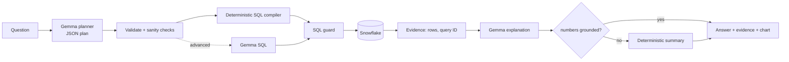

# Ctrl-Z — DataMind: Ask. Query. Verify.

**ZeroDay OSS Hacktoberfest 2026 · PS1 "Talk to Your Data"**

DataMind lets anyone ask questions about structured data in plain English. Every answer is computed by a **live
Snowflake query** at question time and comes with its evidence: the exact SQL that ran, the Snowflake query ID, the
returned rows, the filters, joins and calculations, and every assumption that was made. Google **Gemma** interprets the
question and explains the result; deterministic code builds the SQL, guards it and checks the facts.

> **Verified status (2026-10-18):** live Snowflake + live Gemma 4 (`gemma4:e4b`). Evaluation against independently
> written ground-truth SQL: **38/38 cases pass, 28/28 answers match ground truth** — see [docs/evaluation_results.md](docs/evaluation_results.md).
> 103 offline unit tests pass. What is *not* verified yet is listed under [Verification status](#verification-status).

## Problem

Analysts, students and non-technical users need SQL to explore databases. Dashboards only answer predefined
questions, and generic chatbots invent numbers. DataMind computes answers from the real data and shows its work.
When the data cannot answer a question, it says so instead of guessing.

## Features

* **Natural-language questions** with follow-up context: the last 3 questions and their query plans are sent along,
  so "now just for 1997" or "show only the top 3" work. Result rows are never sent as context.
* **Gemma query planning:** Gemma returns a strict JSON plan, constrained by a JSON schema and validated by Pydantic.
  A **deterministic compiler** turns the plan into SQL: join paths come from configured relationships, named metrics
  come from config, and every value becomes a typed, escaped literal.
* **Advanced path:** for questions the plan format cannot express (e.g. the top item within each group), Gemma writes
  SQL directly. That SQL goes through the same guard and is labelled *model-written* in the UI.
* **SQL guard:** a parser-based (sqlglot), fail-closed check. It allows one read-only SELECT over allowlisted tables
  and known columns, blocks system and table functions, and enforces a row limit. It runs again immediately before
  execution, on top of a read-only Snowflake role.
* **Live Snowflake execution:** the official connector, a statement timeout, bounded fetching with truncation
  detection, and the query ID of every executed statement.
* **Grounded answers:** Gemma's explanation is shown only if every number in it appears in the returned rows or query
  metadata. Otherwise a deterministic summary is shown and the rejected numbers are listed.
* **Honest edge cases:** clarification questions (with the real filter values when a value doesn't exist),
  unsupported requests (missing data, writes, forecasts), "no matching rows" without overclaiming, NULL and truncation
  disclosure, tie disclosure at top-N cut-offs, and warnings when a join may double-count values (fan-out).
* **Schema discovery** from `INFORMATION_SCHEMA`, shown in a searchable schema explorer. Distinct values of configured
  categorical columns are fetched once, so filters use real values.
* **Visualization studio:** bar, line, pie, area and scatter charts plus the raw table, built only from the returned
  rows (never re-aggregated). Charts that would mislead are refused with a reason — e.g. a pie chart of averages or
  negative values, or a line chart without a time axis. Download as CSV, Markdown report or interactive HTML.
* **Re-run:** the exact SQL of any earlier answer can be re-run against current data to get a fresh query ID.
* **Adapts by configuration:** a dataset is a TOML file in `datasets/`. TPC-H and Our World in Data CO₂ are included.

## Architecture



Details, component responsibilities and the security layers: [docs/architecture.md](docs/architecture.md).

| Layer | Technology |
|---|---|
| UI | Streamlit 1.52 (home, query workspace, analysis page) |
| Data platform | Snowflake (`snowflake-connector-python` 5.0), read-only role |
| Model | Google Gemma 4 E4B (`gemma4:e4b`) on Ollama 0.40.5, local GPU; any Gemma tag is configurable |
| Validation | Pydantic 2, sqlglot 30 |
| Charts | Plotly 7 |
| Tests | pytest 9 |

## Setup

### Prerequisites
* Python 3.11+ (tested: 3.11.0 on Windows 11)
* A Snowflake account (the free trial works; organizers do not supply one)
* [Ollama](https://ollama.com) 0.40 or newer (needed for Gemma 4) and a GPU with about 8 GB of VRAM.
  Tested: RTX 4060 Laptop, 8 GB, model fully on the GPU.

```bash
git clone https://github.com/ZERODAY-2026/Ctrl-Z.git && cd Ctrl-Z
python -m venv .venv && .venv\Scripts\activate      # macOS/Linux: source .venv/bin/activate
pip install -r requirements.txt
cp .env.example .env                                 # then edit .env
```

### Snowflake setup
1. Sign up at signup.snowflake.com (trial). Check that the `SNOWFLAKE_SAMPLE_DATA` database exists. If it doesn't, run
   `CREATE DATABASE SNOWFLAKE_SAMPLE_DATA FROM SHARE SFC_SAMPLES.SAMPLE_DATA;`.
2. `python scripts/generate_keypair.py`. This writes `.secrets/datamind_rsa_key.p8` (git-ignored) and prints a public key.
3. Paste the public key into `scripts/snowflake_setup.sql`, then run the whole script in a Snowsight worksheet as
   ACCOUNTADMIN. It creates the X-Small auto-suspending warehouse `DATAMIND_WH`, the read-only role `DATAMIND_READER`,
   the service user `DATAMIND_APP`, and a writable demo copy `DATAMIND_DEMO.TPCH`. The script is safe to re-run.
4. In `.env`, set `SNOWFLAKE_ACCOUNT` (Snowsight → account menu → *Account identifier*), `SNOWFLAKE_USER=DATAMIND_APP`
   and `SNOWFLAKE_PRIVATE_KEY_FILE=.secrets/datamind_rsa_key.p8`.

   *Quick alternative:* use your own login with `SNOWFLAKE_PASSWORD`, or `SNOWFLAKE_AUTHENTICATOR=externalbrowser`
   if your account enforces MFA. Your default role is used unless you set `SNOWFLAKE_ROLE`. That works, but you lose
   the least-privilege guarantee.

### Gemma setup
```bash
ollama pull gemma4:e4b         # 6.6 GB download
ollama serve                   # if not already running
```
Any Gemma tag works through `GEMMA_MODEL` (e.g. `gemma3:12b`, or `gemma2:9b` on older Ollama versions). On an 8 GB
GPU keep `GEMMA_NUM_CTX=6144`. An optional `GEMMA_PROVIDER=google_ai_studio` path (hosted Gemma, `GEMMA_API_KEY`) is
implemented but **has not been verified**.

### Verify, run, test
```bash
python scripts/check_connections.py     # PASS/FAIL per gate, with Snowflake query IDs and Gemma latency
streamlit run app.py                    # http://localhost:8501
pytest -m "not live"                    # offline unit tests
pytest -m live -v                       # real Snowflake + Gemma (skips with a reason if not configured)
python scripts/run_eval.py              # evaluation vs independent ground-truth SQL -> docs/evaluation_results.md
```

## Example questions (TPC-H SF1)
* How many customers are there in each market segment?
* What are the top 5 nations by total revenue?
* How did monthly order count change during 1996?
* Which region had the highest revenue in 1995?
* What is the total revenue by region? → follow-up: *Now just for 1997*
* What percentage of revenue comes from each ship mode?
* For each region, which nation's customers generated the highest revenue? *(advanced path)*

## Using another dataset (configuration only)
Create a TOML file like [`datasets/tpch_sf1.toml`](datasets/tpch_sf1.toml) containing: database, schema, the table
allowlist, many→one relationships, named metrics, categorical columns and example questions. Then set
`DATAMIND_DATASET_CONFIG`, or pick the dataset in the workspace header. The repository includes
[`datasets/owid_co2.toml`](datasets/owid_co2.toml); load its data with
`python scripts/load_owid_co2.py --role ACCOUNTADMIN`. To point the same config at a copy of the data, set
`DATAMIND_DATABASE` / `DATAMIND_SCHEMA`.

## "Answer changes when data changes"
See [`scripts/demo_data_change.sql`](scripts/demo_data_change.sql) and step 6 of the [demo script](docs/demo_script.md).

## Data and model licences
| Item | Source | Terms |
|---|---|---|
| TPC-H SF1 | `SNOWFLAKE_SAMPLE_DATA`, shared by Snowflake into every account | No open licence stated. Used inside your own account only; **no data is in this repository**. TPC-H is a TPC benchmark (synthetic data). |
| OWID CO₂ | [github.com/owid/co2-data](https://github.com/owid/co2-data) | CC BY 4.0. Credit: *Our World in Data*. Some underlying series are third-party (e.g. Global Carbon Project) with their own terms. Downloaded at setup time, not committed. |
| Gemma 4 E4B | Google, via Ollama (`gemma4:e4b`) | Apache 2.0 (the licence shipped with the Ollama model; check Google's model card). Weights are not redistributed here. |
| DataMind code | this repository | MIT ([LICENSE](LICENSE)) |

## Cost and resource notes
Each question runs one query; some TPC-H joins scan LINEITEM (6M rows), which takes seconds on an X-Small warehouse.
Schema discovery is cached for 15 minutes and costs 2 metadata queries plus one small `DISTINCT` per categorical
column. The warehouse auto-suspends after 60 s, statements time out after 60 s, and Snowflake's result cache is
enabled. Gemma runs locally and has no per-token cost.

## Security
* No secrets in the repository: `.env`, `.secrets/` and `*.p8` are git-ignored, and the UI shows only redacted
  configuration.
* A read-only Snowflake role, the parser-based guard (re-run before execution), timeouts and row limits.
* User text, database values and model output are all treated as untrusted. Gemma never receives credentials or
  environment variables, and receives at most 30 result rows for explanation.
* The guard is defence in depth over the read-only role. Its supported subset is a single SELECT (with optional
  CTEs, subqueries, set operations and window functions) over allowlisted tables. It is **not** proven to stop every
  possible hostile SQL string.

## Known limitations
* **Speed:** a local model takes about 15–35 s per question (median 17.2 s in the evaluation), longer if a
  re-plan is needed. The first question also loads the model.
* **Small-model errors:** the model sometimes drops a grouping column or a filter. A deterministic sanity check
  catches the common cases and re-plans once.
* **Model-written SQL** (advanced path) is validated for safety, **not proven correct**, and is labelled in the UI.
* **Plan format** has no self-joins, no side-by-side comparison of two periods, and no ratio of two different
  aggregates (those use the advanced path).
* **Ambiguous joins:** NATION can link via CUSTOMER or SUPPLIER. DataMind picks one path and discloses the choice.
* **Number check scope:** the grounding check verifies numbers only, not every textual claim, and allows rounding
  within 0.5%.
* **Approximate row counts** in the schema explorer come from `INFORMATION_SCHEMA`.

## Verification status
| What | Status |
|---|---|
| Offline unit tests (`pytest -m "not live"`) | **103 passed** |
| Live evaluation, TPC-H SF1, live Snowflake + `gemma4:e4b` | **38/38 cases pass, 28/28 answers match ground truth**; every answered case has a Snowflake query ID ([results](docs/evaluation_results.md), [method](docs/evaluation.md)) |
| Second dataset (OWID CO₂) live | **Not yet verified** — the data has not been loaded into Snowflake |
| "Answer changes when data changes" demo | **Not yet verified** — needs the `DATAMIND_DEMO.TPCH` copy from the setup script |
| Hosted Gemma (`google_ai_studio`) | Implemented, **not verified** |

## Main technical contribution
A Gemma-plans / code-executes pipeline. Gemma's role is limited to two things: a schema-constrained JSON plan, which
deterministic code compiles to SQL over configured join paths, and an explanation that must survive numeric
grounding against the executed result. Every answer links to a real Snowflake query ID.

## Troubleshooting
| Symptom | Fix |
|---|---|
| "Snowflake is not configured" | Fill `.env`; run `python scripts/check_connections.py` |
| Authentication failed | Check the account identifier format (`org-account`) and the key file path, or use `SNOWFLAKE_AUTHENTICATOR=externalbrowser` |
| "No usable Snowflake warehouse" | `GRANT USAGE ON WAREHOUSE DATAMIND_WH TO ROLE DATAMIND_READER`, or set `SNOWFLAKE_WAREHOUSE` to a warehouse the role can use |
| Role cannot access an object | `GRANT IMPORTED PRIVILEGES ON DATABASE SNOWFLAKE_SAMPLE_DATA TO ROLE DATAMIND_READER` |
| "Gemma model not installed" | `ollama pull gemma4:e4b` |
| HTTP 412 "requires a newer version of Ollama" | Upgrade Ollama to 0.40+, or set `GEMMA_MODEL=gemma2:9b` |
| `llama runner process has terminated: CUDA error` | Lower `GEMMA_NUM_CTX` (6144 or 4096) |
| Occasional HTTP 500 "model runner has unexpectedly stopped" | Transient Ollama error; DataMind retries automatically |
| Very slow answers | The first question loads the model; a GPU with more VRAM avoids CPU offload |
