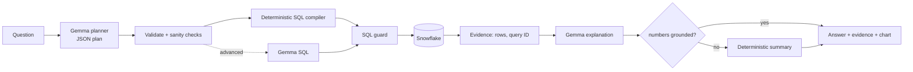

# Ctrl-Z — DataMind: Ask. Query. Verify.

**ZeroDay OSS Hacktoberfest 2026 · PS1 "Talk to Your Data"**

> 🚧 **Work in progress: initial scaffold.** This commit contains the configuration, the query-plan schema, the
> dataset configuration and the Snowflake setup script. Live Snowflake execution, the full pipeline, the UI and the
> evaluation are **not yet verified** and will arrive in later commits.

DataMind lets anyone ask questions about structured data in plain English and get answers computed from **live
Snowflake queries**, with the evidence shown: the exact SQL, the Snowflake query ID, the returned rows, and the
filters and assumptions behind each answer. Google **Gemma** interprets questions and explains results.
Deterministic code builds, guards and runs the SQL.

## Problem
Exploring a database usually takes SQL skills. Dashboards answer only predefined questions, and generic chatbots
can invent numbers. DataMind computes answers from the real data and shows its work, or says honestly when the data
can't answer the question.

## Planned design



Details: [docs/architecture.md](docs/architecture.md).

| Layer | Technology |
|---|---|
| Data platform | Snowflake (`snowflake-connector-python`) |
| Model | Google Gemma (`gemma2:9b` via Ollama, local) |
| Validation | Pydantic, sqlglot |
| UI | Streamlit |

## What's in this commit
| Path | Purpose |
|---|---|
| `config/settings.py` | Typed configuration from `.env`; secrets are redacted in diagnostics, and non-Gemma models are rejected |
| `src/schemas/query_plan.py` | Strict Pydantic schema for the plan Gemma must produce |
| `src/utils/errors.py` | Error categories with safe user messages |
| `datasets/tpch_sf1.toml` | Dataset config: table allowlist, join relationships, named metrics |
| `scripts/snowflake_setup.sql` | Least-privilege read-only role, warehouse and key-pair service user |
| `scripts/generate_keypair.py` | Generates a local RSA key pair (the private key stays git-ignored) |
| `scripts/check_connections.py` | Checks the Snowflake and Gemma connections |

## Setup (so far)
```bash
pip install -r requirements.txt
cp .env.example .env          # fill in; never commit .env
python scripts/generate_keypair.py
# run scripts/snowflake_setup.sql in Snowsight as ACCOUNTADMIN (paste the public key first)
ollama pull gemma2:9b
python scripts/check_connections.py
```

## Data and model licences
| Item | Terms |
|---|---|
| TPC-H SF1 (`SNOWFLAKE_SAMPLE_DATA`) | Shared by Snowflake into each account. No open licence is stated, so it is used in-account only and **not stored in this repo** |
| Gemma 2 | [Gemma Terms of Use](https://ai.google.dev/gemma/terms); weights are not redistributed |
| This code | MIT ([LICENSE](LICENSE)) |

## Status
- [x] Configuration, plan schema, dataset config, Snowflake setup script
- [x] Local Gemma inference reachable (Gemma 2 9B on Ollama)
- [ ] Live Snowflake connection verified
- [ ] SQL compiler and SQL guard
- [ ] Grounded explanations and evidence
- [ ] Streamlit UI
- [ ] Tests and evaluation results
