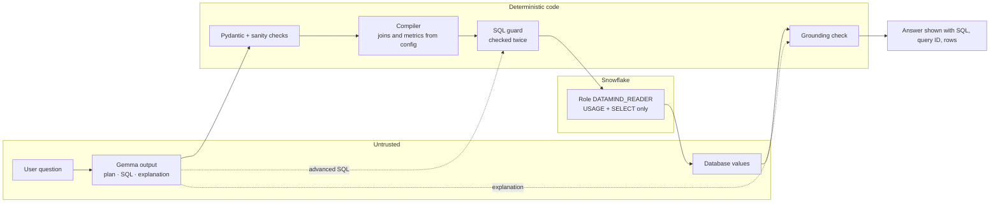
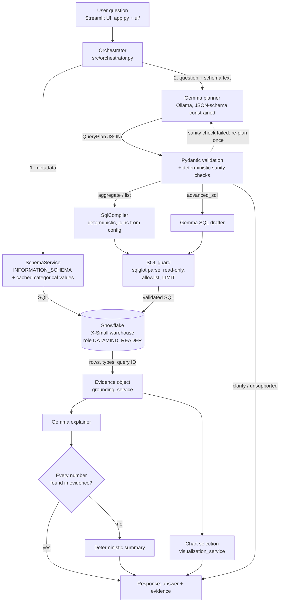

# DataMind architecture

## Trust boundaries

Everything the model produces is treated as untrusted input. Only deterministic code talks to Snowflake.

## Pipeline

## Responsibilities

| Component | File | What it does | Deterministic? |
|---|---|---|---|
| UI | `app.py`, `ui/` | Home, query workspace (schema explorer, answer cards with evidence tabs, chart studio) and analysis page; connection status from real checks; CSV / report / chart downloads | – |
| Orchestrator | `src/orchestrator.py` | Runs the lifecycle; every exit returns a typed `DataMindResponse` | yes |
| Settings | `config/settings.py` | Env/.env/Streamlit secrets, redacted diagnostics, rejects non-Gemma model names | yes |
| Dataset config | `datasets/*.toml` | Database/schema, table allowlist, relationships, named metrics, categorical columns, examples | config |
| Schema service | `src/services/schema_service.py` | `INFORMATION_SCHEMA.TABLES/COLUMNS`, bounded `DISTINCT` for categorical columns, TTL cache, prompt context | yes |
| Gemma service | `src/services/gemma_service.py` | Planning (structured), SQL drafting (advanced path), explanation; repair-once on invalid JSON | **model** |
| Query plan | `src/schemas/query_plan.py` | Strict Pydantic schema (`extra=forbid`, enums, cross-field checks) | yes |
| SQL compiler | `src/services/sql_service.py` | Plan → SQL via sqlglot AST; identifier resolution, typed literals, join paths, fan-out warnings | yes |
| SQL guard | `src/security/sql_guard.py` | Single read-only SELECT, allowlisted tables/columns, forbidden functions, LIMIT | yes |
| Snowflake service | `src/services/snowflake_service.py` | Official connector, statement timeout, bounded fetch, query ID, error classification | yes |
| Grounding | `src/services/grounding_service.py` | Evidence object, deterministic summary, numeric claim verification | yes |
| Visualization | `src/services/visualization_service.py` | Chart choice from real column types and shape | yes |
| Chart studio | `src/services/chart_studio.py` | Builds bar/line/pie/area/scatter charts from the returned rows only (no re-aggregation); refuses misleading charts with a reason | yes |
| Follow-ups | `src/services/followup_service.py` | Suggests follow-up questions from the result shape; clicking one asks a real question | yes |

## Separation of model and execution

Gemma never touches Snowflake. On the main path it emits a JSON plan; SQL is compiled by code.
On the advanced path its SQL is untrusted input to the same guard. Gemma's explanation is shown only
if every number in it appears in the returned rows/metadata; otherwise a deterministic summary is shown and
the rejected numbers are listed in *Query details*.

## Join path selection

Relationships are declared many→one in the dataset config. The compiler connects all required tables
with a greedy Steiner-tree search (Dijkstra over the relationship graph). Passing through a table the plan did not
mention costs more, and shared dimensions (e.g. `NATION`, used by both `CUSTOMER` and `SUPPLIER`) are attached last,
so they link through a table the question mentioned. When another link was possible, the choice is disclosed as an
assumption ("NATION was linked through CUSTOMER; it could also relate to SUPPLIER").

## Security layers

1. Snowflake role `DATAMIND_READER`: `USAGE` + `SELECT` only (scripts/snowflake_setup.sql).
2. Statement timeout (`STATEMENT_TIMEOUT_IN_SECONDS`) per session, warehouse auto-suspend 60 s.
3. SQL guard (parser-based, fail-closed), applied again immediately before execution.
4. Bounded `fetchmany(max_rows + 1)` to detect truncation.
5. Prompts contain metadata, configured categorical values and (for explanation) at most 30 result rows. No
   credentials or environment variables are ever sent to the model.
